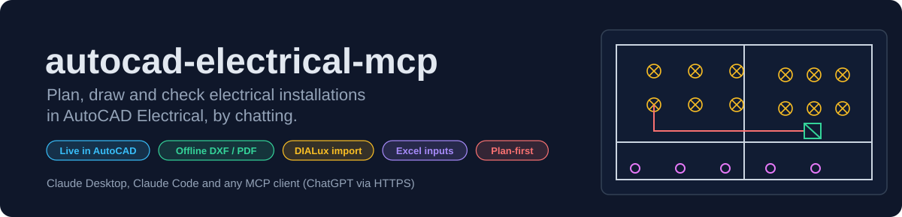
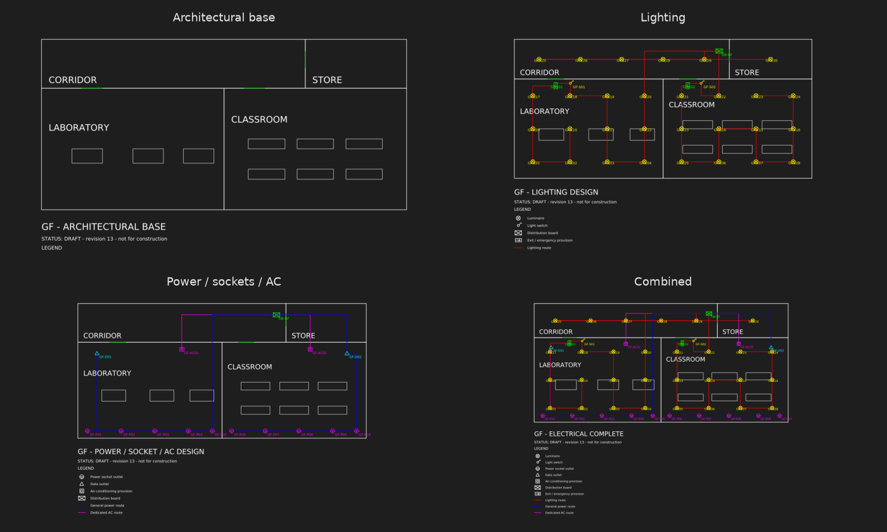
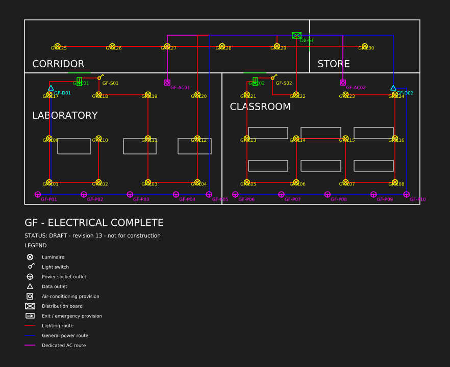
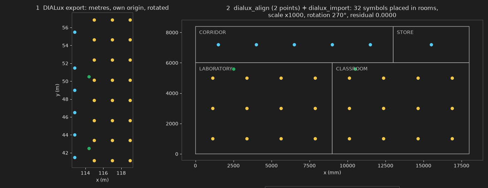
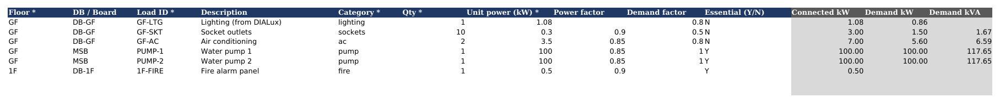
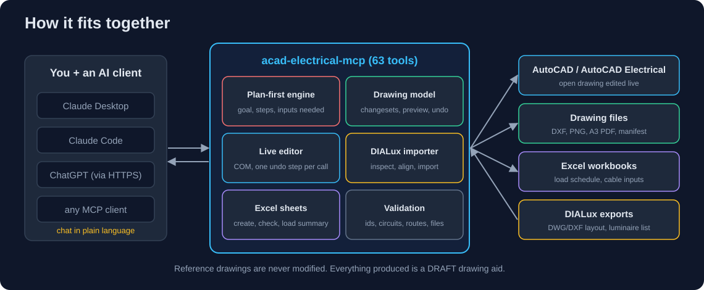
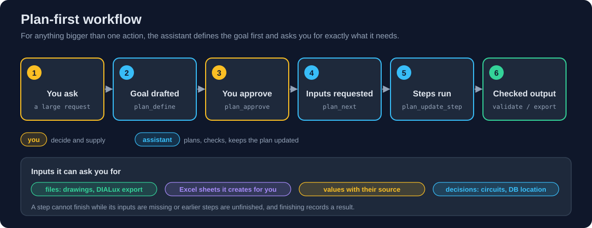
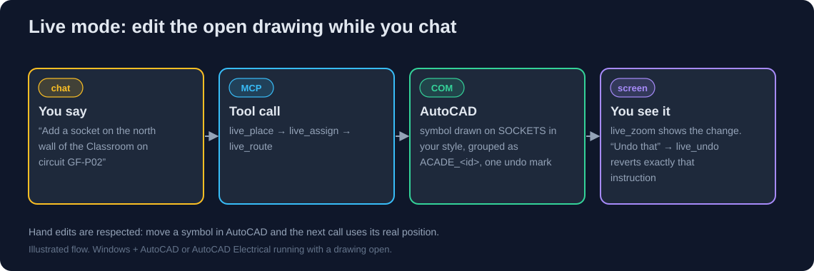
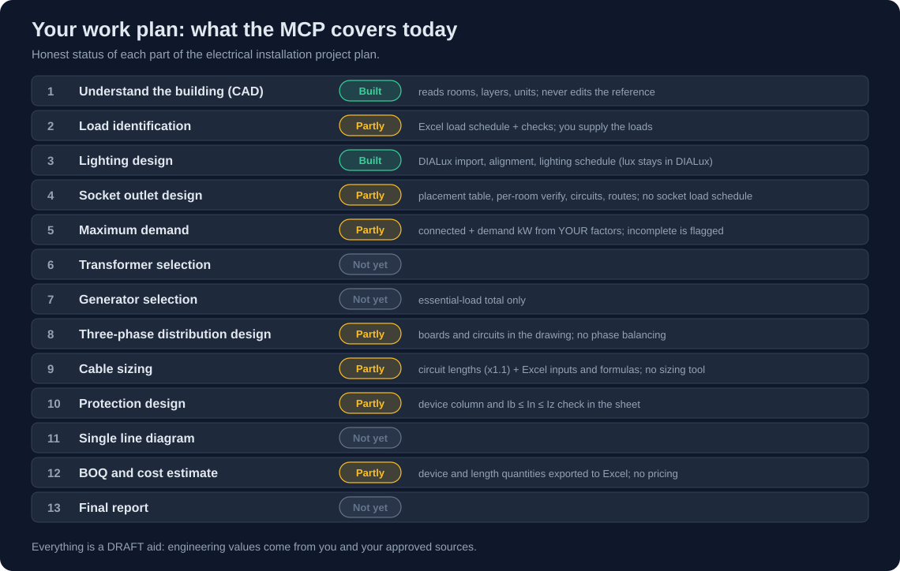

<p align="center">
  
</p>

<p align="center">
  <a href="https://github.com/Dulaj-04/autocad-electrical-mcp/actions/workflows/ci.yml"></a>
  
  
  
  
</p>

<p align="center">
  <a href="#see-it-in-action">See it</a> ·
  <a href="#workflows">Workflows</a> ·
  <a href="#things-to-try">Things to try</a> ·
  <a href="#where-it-stands">Where it stands</a> ·
  <a href="#quick-start">Quick start</a> ·
  <a href="#commands">Commands</a>
</p>

**autocad-electrical-mcp** connects an AI assistant (Claude, or ChatGPT through a connector) to your electrical design work. You describe what you want in plain language; it plans the work with you, asks for the inputs it needs, draws and edits the drawings, and checks the result.

> *"Add a socket on the north wall of the Classroom, put it on circuit GF-P02, redraw the route, and undo that."*
> With AutoCAD open the change appears on screen as you type. Without AutoCAD, the same assistant builds the drawings as editable DXF files with PNG and PDF previews.

> Everything produced is a **DRAFT drawing and calculation aid**. Ratings, factors and table values always come from you and your approved sources; the server never invents them and implies no engineering approval.

## What you get

| Capability | What it does |
| --- | --- |
| **Live editing in AutoCAD** | Place, move, delete and re-route devices in the drawing that is **open**, one undo step per instruction. Your existing symbols can be given stable ids without changing their geometry. |
| **Plan-first working** | For large requests the assistant writes a goal and a step plan, you approve it, and it tells you exactly which files, Excel sheets, values and decisions it needs from you. |
| **DIALux import** | Bring a DIALux DWG/DXF layout onto your architecture, attach wattages from a luminaire list, and get a lighting schedule per room. |
| **Excel input sheets** | Sheets for the load schedule, lighting requirements, luminaire list and cable inputs, with checks that name the row and column of every mistake. Connected load and maximum demand from your factors. |
| **Drawing packages** | Four views per floor from one model (architectural, lighting, power/sockets/AC, combined) exported to DXF, PNG, A3 PDF and a manifest. |
| **Checks** | Unique ids, circuits on the right board, routes tied to circuits, devices inside rooms, units and scale warnings, hand edits detected. |
| **Schematic mode** (optional) | Reads AutoCAD Electrical schematics (components, tags, wire numbers) and probes your install. Writing schematics is not built yet. |

## See it in action

*All pictures below were generated by this server's own tools from a synthetic demo floor (sample data, not a real project). Regenerate them with `python scripts/make_readme_images.py`.*

### One model, four drawings
Every view is generated from the same floor model, so they always agree. Labels stay horizontal even when a symbol is rotated.



The combined sheet at full size, with title, DRAFT status line, legend, and separate routes for lighting (red), power (blue) and AC (magenta):



### A DIALux layout, aligned and imported
DIALux exports in metres from its own origin, rotated. Two matching points are enough to align it with your architecture (here: 32 symbols placed, **0 outside any room**, residual 0.0000).



The lighting schedule that results (sample wattages from a luminaire list; installed load only, no demand factor, no lux calculation):

| Room | Luminaires | Installed | Area | W/m² |
| --- | ---: | ---: | ---: | ---: |
| LABORATORY | 13 | 435 W | 54.0 m² | 8.06 |
| CLASSROOM | 13 | 435 W | 54.0 m² | 8.06 |
| CORRIDOR | 5 | 60 W | 31.2 m² | 1.92 |
| STORE | 1 | 12 W | 12.0 m² | 1.00 |
| **Total** | **32** | **942 W** | | |

### Excel sheets you fill in
The assistant creates the sheet, tells you what to enter, then reads it back and checks it. Grey columns are visible Excel formulas; required columns are marked `*`.



From that sample, `load_summary` reports (and refuses to hide the gap): connected **211.58 kW**, demand **207.96 kW**, essential **200.5 kW**, and `complete: false` because the fire alarm panel (`1F-FIRE`) has **no demand factor**, so it is left out of the demand total, never assumed to be 1.

### A plan that tells you what it needs
This is real `plan_show` output after three steps of the *load and maximum demand* plan:

```text
# Load schedule and maximum demand  (approved)

**Goal:** Connected load and maximum demand per floor and board from approved factors.
**Progress:** 3/6 steps

- [x] l1. Create the load schedule workbook
- [x] l2. Fill in loads (you, in Excel)
- [x] l3. Check the workbook
- [ ] l4. Connected load and maximum demand (waiting: needs demand_factors)
- [ ] l5. Essential load total for generator selection (waiting: after l4; needs essential_loads, pump_data) [not automated yet]
- [ ] l6. Review results with the user and record decisions (waiting: after l4)

**Needed from you:**
- Demand/diversity factors and their source (demand_factors): Fill the Demand factor column per row (0-1) and name the source. Leave blank if unknown: it will be listed as missing, not assumed.
- Which loads are essential (run on the generator): Mark the Essential column Y/N per row.
- Pump data (2 x 100 kW): starting method, efficiency, power factor
```

## How it fits together



## Workflows

### 1. Plan-first: from a big request to a checked result


Ready-made plan templates: **lighting from DIALux**, **load schedule and maximum demand**, **cable and protection inputs**, **drawing from a reference**, **SLD and BOQ**, and **the whole project** as a roadmap. Steps that are not automated yet are labelled so a plan never pretends otherwise. Details: [docs/planning.md](docs/planning.md).

> *Try:* "I need the lighting for the whole 4th floor from our DIALux model, then the load schedule. Plan it first and tell me what you need from me."

### 2. DIALux layout to lighting schedule
| Step | Tool | You provide |
| --- | --- | --- |
| Floor model from your architecture | `prepare_floor_model` | the DXF/DWG and the room list |
| See what the export contains | `dialux_inspect` | the DIALux DWG/DXF export (luminaires as blocks) |
| Align it to the architecture | `dialux_align` | two points seen in both drawings |
| Check wattages | `import_luminaire_list` | the luminaire list (CSV/XLSX) |
| Import as a reviewable changeset | `dialux_import`, `preview_changes` | a decision after reviewing counts, warnings, missing wattages |
| Draw it | `apply_changes` or `live_import_luminaires` | approval (the live import does a dry run first) |
| Total the load | `lighting_schedule` | |

Guard rails: a scale/units check, a count of luminaires outside every room, and a list of types without wattage. Guide: [docs/dialux.md](docs/dialux.md).

### 3. Live editing in AutoCAD


An example session:

```text
You     live_connect, then adopt the symbols already in this drawing for floor 4F
Claude  Attached to the open drawing. Recognised the luminaires, sockets, emergency
        symbols, AC units and switches and gave each a stable id (4F-LUM-01 ... DB-4F).
You     Put a socket on the north wall of the Classroom, 1 m in from the left corner,
        circuit 4F-P02 on DB-4F, and redraw that route.
Claude  Placed 4F-SKT-34, assigned it to 4F-P02, redrew the route and zoomed there.
You     Undo that. Now move DB-4F 2 m left.
Claude  Undone (one step). Moved DB-4F; routes through it are marked stale, redrawing 4F-P02.
```

*An illustration of the flow, not a recording of a real session.*

Every device is wrapped in a named AutoCAD group `ACADE_<id>`, which survives saving and your own hand edits. Guide: [docs/live.md](docs/live.md).

### 4. Offline drawing package (no AutoCAD needed)
`prepare_floor_model` → `plan_devices` / `propose_lighting_grid` / `set_circuit_assignment` / `plan_routes` → `preview_changes` → `apply_changes` → `validate_drawing` → `export_package`. The output folder holds a DXF, PNG and PDF per view and a `manifest.json` with file hashes and the validation result. Reference drawings are never modified, and a repeated plan creates no duplicates.

### 5. Loads to maximum demand with Excel
`workbook_create` → you fill in `load_schedule.xlsx` → `workbook_read` (row and column of every problem) → `load_summary` → results and assumptions recorded in the plan. Demand factors are yours; missing ones are reported, not defaulted.

### 6. Schematic mode (optional, read-only for now)
Say "switch to schematic mode". `sch_detect` reports whether Electrical is loaded (with evidence), `sch_read` lists components, tags and wire numbers, `sch_probe` lists the commands your install exposes. The plan-symbol tools are blocked in this mode so the two are never mixed by accident.

## Things to try

| Say this | What happens | Needs |
| --- | --- | --- |
| "Run `acad-electrical-mcp --selftest`" (terminal) | Starts the server, lists the tools, exits 0 if healthy | nothing |
| "Run `live_selftest`" | Draws, moves, routes and removes test objects in the open drawing to prove the connection | AutoCAD open, scratch drawing |
| "`live_connect`, then `live_scan`" | Reports layers, units and the symbols it recognises, changes nothing | a drawing open |
| "Adopt the symbols on floor 4F, ignoring pieces under 100 mm" | Gives existing symbols stable ids without touching geometry | a drawing open |
| "Move DB-4F 2 m left, then undo" | Moves it, flags stale routes, undoes in one step | adopted devices |
| "Register `sample_floor.dxf` as floor GF of project demo with these rooms…" | Builds the floor model from a reference | a DXF |
| "Propose a lighting grid in the Laboratory at 2.5 × 2 m on circuit GF-L01, preview it, then apply" | Draft placement as a changeset you review first | a floor model |
| "Export the package" | DXF, PNG, A3 PDF and a manifest with validation | a floor model |
| "Run `dialux_inspect` on this export" | Lists block names, counts, layers, units | a DIALux DWG/DXF |
| "Align the DIALux export using these two points… then import with this luminaire list" | A reviewable changeset with warnings | export + luminaire list + two points |
| "Create the load schedule workbook and tell me how to fill it in" | Excel sheet with instructions and formulas | nothing |
| "Check my load schedule and give me connected load and maximum demand" | Row/column errors, then totals from your factors | the filled sheet |
| "Plan the whole project from the work plan" | A roadmap of separate plans with what is automated and what is not | the work plan |
| "Switch to schematic mode and run `sch_detect`" | Evidence on whether Electrical is loaded; counts of components and wires | AutoCAD Electrical |

## Where it stands



| Area | Status |
| --- | --- |
| Offline workflow, exports, validation, MCP protocol, plan-first, Excel sheets, DIALux logic | Automated tests on Python 3.10 and 3.12 (CI) |
| Server install, Claude Desktop connection | Confirmed on a Windows PC |
| `live_selftest` on **AutoCAD Electrical 2026**, AutoLISP link | Confirmed on real AutoCAD |
| `live_adopt`, `live_delete`, `live_undo`, `live_zoom`, `live_texts`, `live_import_luminaires`, `sch_*` | Tested against a simulated AutoCAD only; try on a scratch copy and report errors |
| DIALux import | Tested on synthetic DIALux-style exports; **not yet run on a real DIALux export** (send one to tune it) |
| Schematic insert / wiring / wire numbering / reports | Not built (needs the AutoCAD Electrical API signatures) |
| Transformer, generator, automated cable sizing and protection, SLD, BOQ | Not built; Excel inputs and formulas exist for cables and protection |
| Layouts and viewports | Not supported (model space only) |

DWG output offline needs the free [ODA File Converter](https://www.opendesign.com/guestfiles/oda_file_converter); otherwise `export_package` lists DWG as skipped with the reason. Floor-plan routes are drawing geometry, not an AutoCAD Electrical wire network.

---

## Quick start

> Naming: the repository is `autocad-electrical-mcp`; the Python package and the command it installs are `acad-electrical-mcp`.

### Windows (recommended, includes live AutoCAD)
1. Download this repo (*Code → Download ZIP*) and extract it to a permanent folder such as `C:\Tools\autocad-electrical-mcp`.
2. In PowerShell, inside that folder:
   ```powershell
   powershell -ExecutionPolicy Bypass -File scripts\install-windows.ps1
   ```
   It creates the venv, installs, runs the self-test and adds the server to Claude Desktop's config.
3. Quit Claude Desktop from the tray, reopen, start a **new** chat.

Step-by-step with troubleshooting: [docs/windows-setup.md](docs/windows-setup.md).

### Any OS (offline mode)
```bash
git clone https://github.com/Dulaj-04/autocad-electrical-mcp.git && cd autocad-electrical-mcp
python -m venv .venv && source .venv/bin/activate     # Windows: .venv\Scripts\activate
pip install -e .
acad-electrical-mcp --selftest                         # prints "SELFTEST OK ... 63 tools"
acad-electrical-mcp --make-sample sample_floor.dxf     # optional demo drawing
```
Python 3.10+. Output goes to `./acad_mcp_workspace` (change with `ACAD_MCP_WORKSPACE` or `--workspace`).

### Connect to an AI client

**Claude Desktop** — add to `claude_desktop_config.json` (full path to the venv's executable, doubled backslashes on Windows; the Windows installer does this for you):
```json
{
  "mcpServers": {
    "acad-electrical": {
      "command": "C:\\Tools\\autocad-electrical-mcp\\.venv\\Scripts\\acad-electrical-mcp.exe",
      "env": { "ACAD_MCP_WORKSPACE": "C:\\Users\\YOU\\Documents\\acad_drawings" }
    }
  }
}
```

**Claude Code**
```bash
claude mcp add acad-electrical -- /full/path/to/.venv/bin/acad-electrical-mcp
```

**ChatGPT / any remote MCP client** — needs HTTPS, so run the HTTP transport behind a tunnel:
```bash
acad-electrical-mcp --transport http --port 8000 --allowed-host abc123.ngrok-free.app
```
Then add `https://abc123.ngrok-free.app/mcp` as a connector (ChatGPT *Settings → Connectors*, developer mode; availability depends on your plan). The HTTP endpoint has **no authentication**, so keep the tunnel short-lived. Live AutoCAD tools only work when the server runs on the same Windows PC as AutoCAD.

---

## Commands

<details>
<summary><b>MCP tools (63)</b>: what the assistant can call. Full parameters: <a href="docs/tools.md">docs/tools.md</a> (generated from the running server)</summary>

| Group | Tool | What it does |
| --- | --- | --- |
| **Plan-first** | `plan_templates` | List the plan templates (DIALux lighting, load and maximum demand, cable and protection, drawing from reference, SLD/BOQ, whole project) and the Excel sheets. |
| | `plan_define` | Start a plan for a large request: goal, success criteria, scope, optional template. Draft until you approve it. |
| | `plan_show` / `plan_next` | Current plan with progress, what is ready, and exactly what is needed from you. |
| | `plan_approve` | Record that you agreed to the goal (only after you said yes). |
| | `plan_update_step` | Start/finish a step with a result; refused while inputs are missing. |
| | `plan_provide_input` | Record a file/value/decision you supplied; unblocks the steps that need it. |
| | `plan_add_step` / `plan_add_input` / `plan_note` | Extend the plan; record assumptions, decisions and their sources. |
| **Excel inputs** | `workbook_create` | Create an Excel sheet for you to fill in (load schedule, lighting requirements, luminaire list, cable/protection inputs). |
| | `workbook_read` | Check the filled-in sheet: missing fields, bad numbers, factors outside 0-1, duplicates (row and column given). |
| | `load_summary` | Connected load and maximum demand by floor/board/category and essential loads, using only the factors you entered. |
| **Live editing** (Windows + AutoCAD) | `live_connect` | Attach to the open drawing; report name, layers, entity counts, unit scale. Start here. |
| | `live_selftest` | Create, move, route and delete test objects to prove the connection works. |
| | `live_scan` | Find symbols (touching LINEs clustered per layer) in the open drawing. |
| | `live_adopt` | Give existing symbols stable ids (`4F-LUM-01`, `DB-4F`) without changing geometry. |
| | `live_list_devices` | Tracked devices/routes with live positions; flags hand-moved or deleted ones. |
| | `live_texts` | Read TEXT (room names, labels) with positions. |
| | `live_place` | Draw a luminaire / switch / socket / data / ac / emergency / db symbol at x,y. Idempotent. |
| | `live_import_luminaires` | Draw a DIALux export's luminaires into the open drawing as ONE undo step (dry run first). |
| | `live_move` | Move a device to x,y or by dx,dy; marks its routes stale. |
| | `live_delete` | Delete a tracked device. |
| | `live_assign` | Record a device's circuit and DB. |
| | `live_route` | Draw or redraw an orthogonal DB → devices route, labelled with the circuit id. |
| | `live_add_text` / `live_add_polyline` | Add a note or a polyline on a layer. |
| | `live_zoom` | Pan/zoom AutoCAD to a spot so you can see the change. |
| | `live_undo` | Undo the last instruction (one undo step per call). |
| | `live_save` | Save, or Save As. |
| **Mode** | `live_set_mode` | `plan` (default) or `schematic`. |
| **Schematic** (AutoCAD Electrical) | `sch_detect` | Product/version, Electrical loaded?, AutoLISP bridge OK?, counts of components/wire numbers/wires. |
| | `sch_check_commands` | Ask AutoCAD whether command names (e.g. `AEPROJECT`) are registered, including compiled Electrical commands. |
| | `sch_modules` | List loaded compiled modules (ARX); shows whether Electrical's own modules are active. |
| | `sch_read` | Components (tag, description, location, manufacturer, catalog, terminals), wire numbers, wire layers. |
| | `sch_probe` | List the AutoLISP commands/functions your install exposes (`c:ae`, `c:wd`, …). |
| | `sch_run_lisp` | Run AutoLISP (**off** unless `ACAD_MCP_ALLOW_COMMANDS=1`). |
| **Inspect** (offline) | `register_reference` | Hash and inventory a DXF: layers, entities, blocks, units, extents, text. |
| | `inspect_drawing` | Inventory a generated view. |
| | `list_devices` / `list_floors` | Show the floor model / the project's floors. |
| | `get_preview_image` | Render a PNG of a view. |
| **DIALux import** (offline) | `dialux_inspect` | Look inside a DIALux DWG/DXF export: block names, counts, layers, attributes, units. Run first. |
| | `dialux_align` | Shift/rotation/scale that maps the DIALux file onto your architectural drawing, from two matching points. |
| | `import_luminaire_list` | Read a DIALux/Excel luminaire list (CSV/XLSX): type, quantity, wattage, flux. Missing wattage is reported, never guessed. |
| | `dialux_import` | Import luminaires into the floor model as a changeset (rooms assigned, wattage attached, re-import updates in place, scale/units check). |
| | `lighting_schedule` | Luminaires and installed watts per room and floor (W/m² when areas are known), flagging missing wattages. |
| **Prepare** | `prepare_floor_model` | Register the architectural reference and rooms; reports name differences instead of overwriting. |
| | `prepare_template` | Layer colours/lineweights, symbol and text size, status note, title block. |
| **Plan** | `plan_devices` | Propose devices; repeats create no duplicates. |
| | `propose_lighting_grid` | Draft luminaire grid in a room (placement only, no lux calculation). |
| | `set_circuit_assignment` | Create/update a circuit, bind to a DB, assign devices. |
| | `plan_routes` | Propose an orthogonal route tied to its circuit and DB. |
| **Apply** | `preview_changes` | Show a changeset: operations, assumptions, conflicts. |
| | `apply_changes` | Guarded apply (revision, reference hash, hand-edit detection), regenerate, read back. |
| | `undo_last` | Restore the previous revision. |
| | `sync_from_drawing` | Adopt device moves made by hand in the CAD file. |
| **Output** | `generate_views` | Regenerate the four DXF views from the model. |
| | `export_package` | DXF, DWG (if possible), PNG, A3 PDF and `manifest.json` with hashes and validation. |
| | `validate_drawing` | Issues with severity, code and message. |
| **AutoCAD utilities** (Windows) | `acad_status` / `acad_open` | Report the running AutoCAD / open a drawing read-only. |
| | `acad_run_command` | Send a command line (**off** unless `ACAD_MCP_ALLOW_COMMANDS=1`). |

</details>

<details>
<summary><b>Command line and environment variables</b></summary>

| Command | Purpose |
| --- | --- |
| `acad-electrical-mcp` | Start the MCP server on stdio (what Claude Desktop/Code launches). |
| `acad-electrical-mcp --transport http --port 8000 [--host H] [--allowed-host NAME]` | Streamable HTTP for remote clients such as ChatGPT. |
| `acad-electrical-mcp --selftest` | Start the server, list its tools, exit 0 if healthy. Run this first when anything is wrong. |
| `acad-electrical-mcp --make-sample FILE.dxf` | Write a small demo architectural floor. |
| `acad-electrical-mcp --workspace DIR` / `--backend dxf\|autocad` | Choose the project/output folder / drawing backend. |
| `acad-electrical-mcp --version` | Print the version. |
| `python scripts/gen_tool_docs.py [--check]` | Regenerate (or verify) `docs/tools.md`. |
| `python scripts/make_readme_images.py`, `python scripts/make_diagrams.py` | Regenerate the README pictures from the real tools. |
| `scripts\install-windows.ps1 [-Workspace DIR] [-NoConfig]` | One-shot Windows setup. |

| Variable | Meaning |
| --- | --- |
| `ACAD_MCP_WORKSPACE` | Folder for models, plans, Excel sheets and outputs (default `./acad_mcp_workspace`). |
| `ACAD_MCP_BACKEND` | `dxf` (default, offline) or `autocad` (COM) for the offline generator. |
| `ACAD_MCP_REQUIRE_PLAN` | `1` = strict: tools that change drawings refuse until a plan goal is defined and approved. Off by default. |
| `ACAD_MCP_ALLOW_COMMANDS` | `1` enables `acad_run_command` and `sch_run_lisp`. Off by default because they can change any open drawing. |

Prompts offered to MCP clients: `plan_a_request`, `lighting_from_dialux`, `load_schedule_and_demand`, `project_roadmap`.
</details>

## How it works
- **Offline:** one JSON *floor model* per floor (rooms, devices, circuits, routes) is the source of truth; all four views are generated from it. Edits are *changesets*: plan → `preview_changes` → `apply_changes`, guarded by model revision, the reference file hash and hand-edit detection, with a snapshot for `undo_last`. Deterministic ids make repeated plans idempotent.
- **Live:** each device or route is drawn as plain LINE/polyline/TEXT in your reference style on your layers and wrapped in a named AutoCAD group, inside an undo mark. Symbol size comes from the geometry (your reference drawings are millimetres although their header says metres).
- **Plan-first:** the server tells the assistant to define a goal and get approval before large work, and stores the plan per project (`plan.json`). Strict mode (`ACAD_MCP_REQUIRE_PLAN=1`) makes drawing-changing tools enforce it.
- **Schematic:** reads AutoCAD Electrical blocks and attributes and talks to AutoLISP by sending an expression and reading the answer back through a system variable.

## Repository layout
```
.
├── README.md
├── pyproject.toml                 package metadata, dependencies, lint config
├── LICENSE
├── .github/workflows/ci.yml       lint + tests on Python 3.10 and 3.12
├── src/acad_electrical_mcp/
│   ├── server.py                  MCP tools, prompts, CLI, transports (stdio / HTTP)
│   ├── live.py                    LIVE editing of the open AutoCAD drawing (COM)
│   ├── schematic.py               AutoCAD Electrical schematic read + AutoLISP probe
│   ├── symbols.py                 plan-symbol geometry in your reference style
│   ├── plan.py  workbook.py       plan-first engine and templates; Excel sheets and load summary
│   ├── dialux.py                  DIALux export import, alignment, luminaire list, lighting schedule
│   ├── planner.py  model.py       changesets and the floor model store (offline)
│   ├── views.py  export.py        generate the four views; DXF/PNG/PDF/manifest
│   ├── validate.py  inspection.py checks and drawing inventory
│   ├── template.py  ids.py        layers/colours and id rules
│   ├── config.py  sample.py       settings, demo drawing
│   └── backends/                  dxf_backend.py (ezdxf) · autocad_backend.py (COM)
├── scripts/
│   ├── install-windows.ps1        one-shot Windows setup
│   ├── gen_tool_docs.py           builds docs/tools.md from the server
│   ├── make_readme_images.py      README pictures from the real tools (demo data)
│   └── make_diagrams.py           README diagrams (SVG)
├── docs/
│   ├── windows-setup.md           install + troubleshooting
│   ├── planning.md                plan-first workflow, templates, Excel input sheets
│   ├── dialux.md                  importing a DIALux lighting layout
│   ├── live.md                    live mode and schematic mode guide
│   ├── tools.md                   every tool and parameter (generated)
│   └── images/                    README pictures
├── examples/claude_desktop_config.json
└── tests/                         offline workflow, live (simulated AutoCAD), DIALux, plan/Excel, schematic, docs
```

## Troubleshooting
Run `acad-electrical-mcp --selftest` first: `SELFTEST OK` means the server is fine and the problem is in the client or AutoCAD. See [docs/windows-setup.md](docs/windows-setup.md#common-problems) for the common errors (folder moved, mcp 2.x, no tools in chat) and [docs/live.md](docs/live.md) for live-mode requirements (AutoCAD idle, same Windows user).

## Development
```bash
pip install -e ".[dev]"
ruff check . && pytest -q
python scripts/gen_tool_docs.py --check     # docs/tools.md must match the server
```
When you add or change a tool, run `python scripts/gen_tool_docs.py` and add it to the README table (a test fails if the README misses a tool or links to a missing file). The README pictures need matplotlib and, for the Excel picture, LibreOffice Calc and `pdftoppm`.

## License
MIT
