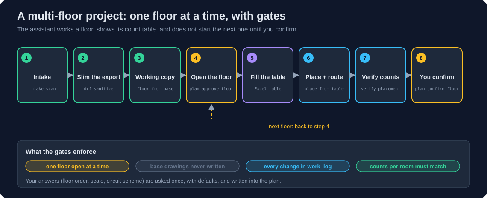
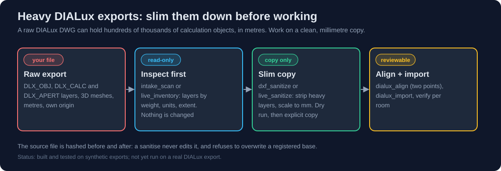

# Multi-floor project workflow

How the server is meant to be used on a real project with several floors, DIALux exports and
architectural bases. It is built from a review of a real project run: what the assistant was
expected to do, what it delivered, and what went wrong.

## The rules the assistant is given
These are in the server instructions, so any MCP client sees them.

1. **Ask first, once, with defaults.** Floor order, units, scale, circuit scheme, socket heights,
   who supplies the loads. The answers go into the plan (`plan_note`, `plan_provide_input`).
2. **Look before touching.** `intake_scan` for files, `live_inventory` for the open drawing.
3. **One floor at a time.** `plan_approve_floor` opens a floor, `plan_confirm_floor` closes it
   (only after you checked it). Strict mode (`ACAD_MCP_REQUIRE_PLAN=1`) enforces this in the
   drawing tools.
4. **Base drawings are never written to.** `base_register` hashes them; `floor_from_base` makes the
   per-floor copy; `base_check` proves nothing changed.
5. **Place from a table, verify from the same table.** `workbook_create` (kind `placement_table`),
   `place_from_table` / `live_place_from_table` in batches, `verify_placement` /
   `live_verify_placement`.
6. **Keep you informed.** After every batch: what was drawn, what remains, what is open.
   `work_log` has the history, `live_resync` repairs the tracking after a crash.

## Step by step

| # | Step | Tools | Output |
| --- | --- | --- | --- |
| 1 | Inventory the inputs | `intake_scan` | kinds, floors, missing floors, duplicates, scale flags, warnings |
| 2 | Define the goal and the floors | `plan_define` (`floors=[...]`), `plan_approve` | plan with floor list |
| 3 | Protect the bases | `base_register` | hash recorded |
| 4 | Slim a heavy DIALux export | `dxf_sanitize` or `live_inventory` + `live_sanitize` | clean millimetre copy |
| 5 | Working copy for the floor | `floor_from_base` | `<floor>_<base>.dwg/.dxf` |
| 6 | Open the floor | `plan_approve_floor` | one open floor |
| 7 | Fill the table | `workbook_create`, `workbook_read` | checked placement table |
| 8 | Draw | `live_place_from_table` (or `place_from_table` + `apply_changes`) | devices, one undo step per batch |
| 9 | Verify | `live_verify_placement` / `verify_placement` | expected vs actual per room and type |
| 10 | Lengths and quantities | `live_circuit_lengths`, `export_circuit_lengths`, `export_quantities` | Excel named ranges |
| 11 | You confirm | `plan_confirm_floor` | floor locked, next floor can open |

## Heavy DIALux exports

* DIALux layers such as `DLX_OBJ`, `DLX_CALC`, `DLX_APERT` are calculation geometry, not drawing content.
* DIALux exports are in **metres**; the reference drawings are in **millimetres**. The sanitise
  tools scale by 1000 only when you say so (`from_units="m"` or `scale=1000`) and never silently.
* `dxf_sanitize` works on DXF files. A DWG needs to be opened in AutoCAD and cleaned with
  `live_sanitize` (the file must be a working copy, never a registered base).
* The DWG contents cannot be read without AutoCAD; `intake_scan` says so instead of guessing.

## What a change affects
`plan_impact` answers "if I change X, what must be redone?" before you change it, e.g. demand
factors affect cable sizes, the SLD, the BOQ and the report, but not the CAD drawings; circuits
affect the drawings.

## Not covered yet
Schematic writing in AutoCAD Electrical, transformer and generator selection, automatic cable
sizing, the single line diagram, BOQ pricing and the report. Their plan steps are labelled
"not automated yet" so a plan never implies otherwise.
